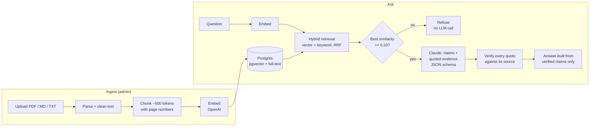

# Grounded

[](https://github.com/RonaldLenser/grounded-rag/actions/workflows/ci.yml)


**A RAG knowledge assistant that answers only from your documents, cites the exact page and passage for every claim, and says so when the answer isn't there.**

**Live demo: https://grounded-1004795551444.us-east4.run.app**

Preloaded with two public NIST documents (AI Risk Management Framework 1.0 and the Generative AI
Profile, 112 pages). Try "What are the four functions of the AI RMF Core?" and then "What is the
capital of France?" to see a cited answer and a refusal. First load after idle takes a few
seconds (scales to zero).

## Highlights

- **The model never writes the answer.** Claude returns structured claims, each with exact quotes
  as evidence. Code checks every quote against the source text and builds the answer only from
  claims that pass. An unsupported claim is dropped, never shown.
- **Refuses instead of guessing.** A relevance gate refuses off-topic questions before any LLM
  call; the threshold (0.20) was calibrated from eval data, not picked by hand.
- **Hybrid retrieval chosen by measurement.** Vector search + IDF-weighted keyword search, merged
  with Reciprocal Rank Fusion. Shipped behind a flag and made the default only after the eval
  showed it fixed both retrieval misses with no regressions.
- **Evaluation harness.** A 33-question golden set run against the live API, scored for retrieval,
  refusals, citations, and (with an LLM judge that states its reasons) claim support and answer
  correctness. Reports are committed in [docs/evals/](docs/evals/).
- **Deployed like a real service.** Cloud Run + Neon Postgres, secrets in Secret Manager, per-IP
  rate limits, and an atomic daily LLM budget enforced in the database. 240+ tests, strict mypy,
  CI on every push.

## Results

Live demo, Claude Sonnet 5.5, judged by Claude Haiku 5.5. Same 33 questions before and after
hybrid retrieval:

| What | Vector only ([v1](docs/evals/2026-10-12-v1.md)) | Hybrid ([v2](docs/evals/2026-10-12-v2-hybrid.md)) |
|---|---|---|
| Answerable questions answered (not refused) | 22 / 24 | **24 / 24** |
| Answers correct vs hand-written reference (LLM judge) | 22 / 22 | **24 / 24** |
| Right page retrieved: top 3 / top 6 | 88% / 92% | **100% / 100%** |
| Retrieval MRR | 0.81 | **0.88** |
| Unanswerable and off-topic questions: no unsupported answer | 9 / 9 | 9 / 9 |
| Shown claims NOT supported by their quotes (LLM judge) | 0 / 78 | 0 / 86 |
| Latency p50 / p95 (LLM answers) | 2.9s / 6.5s | 3.4s / 7.1s |

Small sample, and the keyword method was chosen after seeing these questions' failures: treat this
as a regression check, not a benchmark. Full analysis in [Evaluation](#evaluation).

## How it works



1. **Ingest:** files are checked by content (not extension), parsed page by page, cleaned (PDF
   line-break hyphens repaired), split into ~500-token chunks with 75 tokens of overlap, embedded,
   and stored with page numbers and headings. Duplicate uploads are detected by SHA-256.
2. **Retrieve:** the question is embedded; Postgres returns the top 20 chunks by cosine similarity
   (HNSW index) and the top 20 by IDF-weighted keyword match; Reciprocal Rank Fusion keeps the
   best 6.
3. **Gate:** if no retrieved chunk is similar enough, the API refuses without calling the LLM.
4. **Generate:** sources are labeled `S1..S6` and sent to Claude, which must reply in a JSON
   schema: a status and a list of claims, each with `{source_id, quote}` evidence.
5. **Verify:** a claim is shown only if every quote exists in the source it cites (normalized for
   whitespace, case, and curly quotes). Citation markers are generated by code, not the model.
6. **Respond + log:** the API returns the answer, claims, verified citations (file, page,
   passage), and a status: `answered`, `partial` (with a notice), or `insufficient_context`.

## Design decisions

| Decision | Why | Tradeoff |
|---|---|---|
| Claim-level structured output instead of free text | Removing a bad citation from free text leaves the unsupported sentence visible. With claims, there is no free text left to leak. | Longer outputs (needed a 2048-token cap, found by the eval). |
| Verify quotes in code | Cheap, deterministic, and catches fabricated citations. | Proves the quote exists, not that the claim follows from it. The LLM judge measures that gap. |
| Postgres for vectors and keywords | One database, transactional deletes, no extra service to run. | A dedicated vector DB would scale further; not needed at this size. |
| IDF-weighted keyword search, not `ts_rank` | Postgres's default ranking found 19/24 expected pages; IDF weighting found 22/24 (measured before building). | Custom SQL to maintain. |
| Gate on best cosine score, not first result | Keeps the calibrated threshold meaningful after fusion reorders results. | None found. |
| Atomic daily budget (`INSERT ... ON CONFLICT ... WHERE calls < limit`) | A read-then-write check lets concurrent requests overspend. A test fires 25 concurrent requests at a limit of 10. | Failed LLM calls still count against the budget. |

More in the [design doc](docs/DESIGN.md).

## Stack

Python 3.12 · FastAPI · PostgreSQL + pgvector + full-text search · SQLAlchemy 2.0 (async) +
Alembic · Claude Sonnet 5.5 (generation) · OpenAI `text-embedding-3-small` · Pydantic v2 ·
structlog · pytest · ruff + mypy (strict) · Docker · GitHub Actions · Google Cloud Run + Neon

## Run it

### Docker (quickest)

Requires [Docker](https://www.docker.com/products/docker-desktop/). Copy `.env.example` to `.env`
and set `OPENAI_API_KEY`, `ANTHROPIC_API_KEY`, and `ADMIN_API_KEY`, then:

```bash
docker compose up --build
```

- Web app: http://localhost:8000 (upload documents, ask questions, click citations)
- API docs: http://localhost:8000/docs
- Liveness / readiness: http://localhost:8000/health, http://localhost:8000/ready

Load the demo corpus: `uv run python scripts/seed_demo.py` (add `--replace` to re-ingest after
changing parsing or chunking).

<details>
<summary><b>Local development</b></summary>

Requires [uv](https://docs.astral.sh/uv/) and Docker (for the database).

```bash
cp .env.example .env                    # then edit values as needed
uv sync                                 # install Python 3.12 + dependencies
uv run pre-commit install               # enable commit hooks
docker compose up -d db                 # start only the database
uv run alembic upgrade head             # create/upgrade the schema
uv run uvicorn grounded.main:create_app --factory --reload
```

Database migrations:

```bash
uv run alembic revision --autogenerate -m "describe change"   # then REVIEW the generated file
uv run alembic upgrade head
```

</details>

<details>
<summary><b>API examples</b></summary>

```bash
# create a collection (admin)
curl -X POST localhost:8000/v1/collections \
  -H "X-API-Key: $ADMIN_API_KEY" -H "Content-Type: application/json" \
  -d '{"name": "my-docs"}'

# upload a document: PDF, .md, or .txt (admin)
curl -X POST localhost:8000/v1/collections/<collection-id>/documents \
  -H "X-API-Key: $ADMIN_API_KEY" -F "file=@policy.pdf"

# search: the most relevant chunks for a question
curl -X POST localhost:8000/v1/collections/<collection-id>/search \
  -H "Content-Type: application/json" \
  -d '{"query": "What does the policy say about accountability?", "top_k": 3}'

# ask: a cited answer, or an explicit "not in your documents"
curl -X POST localhost:8000/v1/collections/<collection-id>/query \
  -H "Content-Type: application/json" \
  -d '{"question": "Who is accountable for AI risk?"}'
```

Or use the interactive docs at http://localhost:8000/docs (click **Authorize** and paste the admin key).

</details>

<details>
<summary><b>Tests and smoke test</b></summary>

```bash
uv run pytest                           # all tests (integration tests skip if the DB is down)
uv run pytest -m "not integration"      # unit tests only, no database needed
```

Integration tests run against a real PostgreSQL + pgvector database with fake embeddings and a
fake LLM. They cover migrations (apply and roll back), constraints (deduplication, cascading
deletes), retrieval, the full query pipeline, and budget concurrency.

The smoke test runs end to end against real OpenAI embeddings and Claude:

```bash
uv run python scripts/smoke_test.py                  # local
uv run python scripts/smoke_test.py https://<url>    # a deployed instance
```

</details>

<details>
<summary><b>Deploy</b></summary>

Google Cloud Run + Neon Postgres, with per-IP rate limits and a global daily LLM budget.
Step-by-step guide, including safe secret rotation: [docs/DEPLOY.md](docs/DEPLOY.md).

</details>

## Evaluation

```bash
uv run python -m evals.run https://<url> --judge --label my-run       # writes docs/evals/
uv run python -m evals.run --from-json docs/evals/<run>.json --judge  # re-judge a saved run
```

The harness calls the public HTTP API exactly like a user, so it measures the deployed system.
Golden set: 24 answerable (single- and multi-source), 6 unanswerable but on-topic, 3 off-topic.
Errors count as failures, and collected answers are saved before judging so a judge failure
loses nothing.

What the runs showed:
- **The baseline caught a real bug:** claim-format answers hit the 1024-token output cap and
  returned 502 ([report](docs/evals/2026-10-12-baseline.md)). Fixed with a 2048 cap and at most
  8 claims per answer.
- **Both false refusals were retrieval misses**, not model errors: vector search ranked pages with
  the exact terms ("residual risk", "eliminate negative risk entirely") below the top 6. Hybrid
  retrieval fixed both.
- **The gate threshold has margin:** off-topic questions scored at most 0.14, answerable ones at
  least 0.31; 0.20 sits between them.
- **"Partially supported" claims were checked by hand:** the extra detail came from the source
  document but outside the quoted span, or was attribution wording ("MANAGE 1.3 states...").
  No fabricated fact was found.
- **One unanswerable question got a `partial` answer** with hybrid ("What penalties does NIST
  impose?"): the supported fact that the framework is voluntary, plus a notice that the documents
  only partly answer. No penalty was invented.

## Limitations

- Quote verification proves a quote exists, not that the claim is entailed by it. The LLM judge
  measures this; it found no unsupported claims, but it is a model, not a proof.
- 33 questions is small (one question is about 4 points), and there is no held-out set yet.
- Single-turn Q&A only. No conversation memory, no streaming (answers take 3 to 7 seconds).
- One admin key for writes; no user accounts or per-user collections.
- No OCR: scanned PDFs are rejected. PDF line-break repair is a heuristic and can join a real
  compound word (for example "cost-effective") when the document gives no evidence either way.
- English stemming for keyword search.

## Privacy and data retention

The demo stores each question's raw text in the `query_logs` table (for debugging and evals), with
no automatic expiry; deleting a collection deletes its logs. Answers are not stored, and
application logs never contain question or answer text. Don't ask the public demo anything
personal. Details: "Data retention" in [docs/DESIGN.md](docs/DESIGN.md).

## Roadmap

- [x] M0-M2: Scaffold, CI, schema and migrations, document ingestion
- [x] M3-M4: Vector search; cited answers with verification and refusals
- [x] M5-M6: Web UI; deploy (Cloud Run + Neon, rate limits, daily LLM budget)
- [x] M6.1: Claim-level verification, atomic budget
- [x] M7: Evaluation harness and golden set
- [x] M8: Hybrid retrieval (won the eval, now the default)
- [x] M10: Docs, PDF text repair, demo
- [ ] Held-out question set for an unbiased estimate
- [ ] Streaming (deferred: polish, not core value)

## License

MIT
